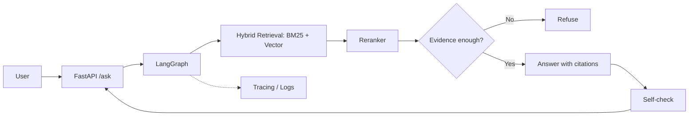

# CiteGuard

> Agentic RAG for technical docs that answers **only with evidence**: every claim is cited, and it refuses when evidence is insufficient.

**Live Demo:** _coming soon — Hugging Face Space not deployed yet._ <!-- TODO: Space URL -->  
<!-- TODO: demo GIF (assets/demo.gif) -->

## What it is
CiteGuard answers questions about the **FastAPI, Pydantic and LangGraph docs** with a *cite-or-abstain* contract:

- Every sentence in an answer must be backed by a retrieved doc chunk, cited as `[n]` with a source URL.
- If retrieval finds too little evidence, or the generated answer fails verification, the API **refuses** and says why (`refusal_reason`) instead of guessing.
- `/ask` and `/ask/stream` always make the same decision (the stream is buffered until verification finishes).

Stack: FastAPI · LangGraph · BM25 + `bge-small-en-v1.5` (RRF hybrid) · Qdrant (embedded) · any OpenAI-compatible LLM (local Ollama by default; OpenRouter tested).

## Architecture
<!-- TODO: replace with final diagram (assets/architecture.png) -->


## Evaluation

### Week 1 — Retrieval (30 handwritten queries)

| Method | Recall@5 | MRR | p95 latency |
|---|---:|---:|---:|
| BM25 | 0.733 | 0.575 | 0.007s |
| Vector | 0.867 | 0.687 | 0.040s |
| **Hybrid (default)** | **0.967** | **0.761** | 0.056s |
| Hybrid + rerank (`ms-marco-MiniLM-L-6-v2`, top-10) | 0.933 | 0.721 | 0.224s |

Notes: corpus 290 docs → **3903** unique chunks after inlining FastAPI `docs_src` example code and no longer splitting on `#` comments inside code fences (was 4100). Hybrid R@5 0.900 → 0.967, MRR 0.723 → 0.761, and now beats the optional rerank mode, so `/search` stays hybrid by default. Previous numbers and the reindex write-up: `docs/eval_week1.md`, `docs/ingest_inline_week3.md`.

### Later weeks (TBD)
| Metric | Baseline RAG | CiteGuard |
|---|---|---|
| Faithfulness (RAGAS) | TBD | TBD |
| Context Recall (RAGAS) | TBD | TBD |
| Refusal Accuracy | TBD | TBD |
| p95 Latency (`/ask`) | TBD | TBD |

Test set: ~100 Q&A pairs incl. unanswerable questions. <!-- TODO: link eval/ -->

Week 2 refuse fixture (20 questions, `expected_refused: true`): [`docs/refuse_samples_week2.json`](docs/refuse_samples_week2.json).

Week 1 retrieval numbers (Recall@5 / MRR): see [`docs/eval_week1.md`](docs/eval_week1.md).

## Quickstart

### Local (no Docker — embedded Qdrant)

```bash
cp .env.example .env
# leave QDRANT_URL empty for embedded mode
sed -i 's|^QDRANT_URL=.*|QDRANT_URL=|' .env

python -m venv .venv && source .venv/bin/activate
pip install -e ".[dev]"

# Raw docs are expected under data/raw/ (see Data Sources). Then:
python scripts/ingest_docs.py          # chunk + BM25 + embeddings → Qdrant
uvicorn citeguard.api.app:app --host 0.0.0.0 --port 8000

curl localhost:8000/health
curl -X POST localhost:8000/search \
  -H 'Content-Type: application/json' \
  -d '{"query":"How do I add CORS in FastAPI?","top_k":5}'

curl -X POST localhost:8000/ask \
  -H 'Content-Type: application/json' \
  -d '{"question":"How do I add CORS in FastAPI?"}'
```

### Docker Compose

```bash
cp .env.example .env   # defaults to local Ollama (qwen2.5:3b-instruct)
docker compose up -d --build
curl -X POST localhost:8000/search -H 'Content-Type: application/json' \
  -d '{"query":"How do I add CORS in FastAPI?","top_k":5}'
curl -X POST localhost:8000/ask -H 'Content-Type: application/json' \
  -d '{"question":"How do I add CORS in FastAPI?"}'
```

HF Spaces tip: unset `QDRANT_URL` so the API uses Qdrant embedded/local disk mode (single container).

## API

### `GET /health`
`status`, `n_chunks`, `qdrant_mode`, `llm_configured`, `version`, `judge_mode`

### `POST /search`
Body: `query`, `top_k`, optional `method` (`bm25|vector|hybrid` **default** | `hybrid+rerank` opt-in).

### `POST /ask` (Week 2 — cite-or-abstain)
Non-streaming JSON. Body: `{ "question": "..." }`.

Response fields (stable):

| Field | Type | Meaning |
|---|---|---|
| `answer` | string | Cited answer, or `""` when refused |
| `refused` | bool | `true` if abstained |
| `refusal_reason` | string\|null | `<class>:<detail>`. Class `no_evidence` (retrieval gate, out-of-scope task, or model said the docs don't cover it), e.g. `no_evidence:top_score_below_threshold:…`, `no_evidence:out_of_scope_task`. Class `ungrounded_answer` (model answered but failed verification), e.g. `ungrounded_answer:unsupported_citation` (formerly `retrieval_miss`), `ungrounded_answer:low_grounding`, `ungrounded_answer:judge_veto:*` (only with `JUDGE_MODE=veto`), `ungrounded_answer:no_supported_sentences`, `ungrounded_answer:missing_citation_markers` |
| `citations` | list | `{ chunk_id, title_path, source_url, score, excerpt }` (empty on early refuse) |
| `method` | string | Retrieval method used (`hybrid` by default; `hybrid+rerank` only if `ASK_USE_RERANK=true`) |
| `request_id` | string | Per-request trace id (also in the `X-Request-ID` response header and the log line) |

Evidence gate (before generation): refuse if RRF top score **&lt; 0.02** **or** total length of top-3 chunk texts **&lt; 200** characters.

LangGraph path: `retrieve → evidence_judge → (refuse | generate) → self_check` (one regenerate, then refuse).

### `POST /ask/stream`
Same body; **SSE** (`text/event-stream`) with events `status`, `token`, `final` (`final.data` matches `/ask` JSON; every event's `data` includes `request_id`). **Buffer-then-stream:** the evidence judge, generation, citation repair and self-check all finish before the first `token` is sent. So the stream never shows text that is later retracted, and it refuses exactly when `/ask` does. The cost is that time-to-first-token equals the full generation time.

**LLM (provider-agnostic, OpenAI-compatible):** configured by `LLM_BASE_URL`, `LLM_MODEL`, `LLM_API_KEY` (optional for Ollama). Leave `LLM_MODEL` empty → deterministic **stub** generator (no network). CI/unit tests always use the stub; a live test is opt-in (`CITEGUARD_OLLAMA_TEST=1 pytest -m ollama`, auto-skips if Ollama is down).

| Provider | `LLM_BASE_URL` | `LLM_MODEL` example | `LLM_API_KEY` |
|---|---|---|---|
| Ollama (default, free, local CPU) | `http://localhost:11434/v1` | `qwen2.5:3b-instruct` | not needed |
| OpenRouter (planned) | `https://openrouter.ai/api/v1` | `qwen/qwen-2.5-7b-instruct` | required |

The LLM sees up to 1200 chars per retrieved chunk; the API response keeps the short `excerpt`. Live end-to-end results with Ollama: [`docs/e2e_week2_ollama.md`](docs/e2e_week2_ollama.md).

## Design Decisions
- **Hybrid retrieval (API default)**: BM25 + `bge-small-en-v1.5` vectors fused with RRF (`k=60`). Best MRR on the Week-1 30-query set; HTTP p95 ~0.04s on CPU.
- **Opt-in rerank**: `method=hybrid+rerank` uses `ms-marco-MiniLM-L-6-v2` on the top-10 RRF hits (512-char truncate). Improves Recall@5 on this set but not MRR; HTTP p95 ~0.21s (clears &lt;1.5s). `bge-reranker-base` was too slow (~2.7s) on CPU.
- **Local models only** for Week 1 (no paid embedding/LLM APIs).
- **Qdrant URL optional**: empty → embedded path under `data/indexes/qdrant_local` (Spaces-friendly).
- **Unique `chunk_id`**: `sha1(doc_id)[:12]-NNNN` (per-doc index) — no collisions.
- **Cite-or-abstain `/ask` (LangGraph)**: evidence gate (top score &lt; 0.02 or top-3 chars &lt; 200) → generate with mandatory `[n]` citations → self-check.
- **LLM optional**: stub without `LLM_MODEL`; any OpenAI-compatible endpoint (Ollama by default, OpenRouter next).

## Known Limitations

Local CPU model `qwen2.5:3b-instruct`. Same 20 answerable + 20 refuse questions throughout. "Before" = first live run, "after" = citation repair + wrong-source refusal + task filter + buffered stream. Details: [`docs/e2e_week2_ollama.md`](docs/e2e_week2_ollama.md).

| Issue | Before | After | Status |
|---|---|---|---|
| Over-refusal from missing or literal `[n]` markers | 4/20 answerable refused (`/ask`) | 0/20 (sentences are mapped to their best-matching retrieved chunk; unmatched ones are dropped) | fixed |
| Answer rate (`/ask` / stream) | 0.55 / 0.45 | 0.75 / 0.75 | improved |
| Wrong-source citations (correct fact, unrelated chunk, e.g. Q4 HTTPException) | answered, with 24 % of cited sentences failing the source check | refused as `ungrounded_answer:retrieval_miss` (Q1, Q4, Q7, Q15; reason since renamed `unsupported_citation`) | fixed by refusing. The root cause is retrieval recall: the right page isn't in the top 5, so answerable questions are still lost |
| ↳ correction to the row above | — | — | This was first thought to be a retrieval-recall problem for all four. Gold-chunk ranks later showed only Q1 and Q4 were recall misses (answer chunks ranked >50). **Q7 and Q15 had the gold chunk at hybrid rank 1 and 3: those were citation-check false rejections.** See `docs/refuse_hard_week3.md` §4 |
| Prompt-echo false answer (refuse #7, toaster poem, stream only) | 1/20 false answer on stream | refused on both paths (`no_evidence:out_of_scope_task`) | fixed (narrow regex for creative-writing requests) |
| `/ask` vs stream disagreement | refusal accuracy 1.00 vs 0.95; 2/20 answerable decisions differ | identical decisions on all 40 questions | fixed (buffer-then-stream) |
| Factually wrong but uses the chunk's words (Q9 `response_model` described as a function parameter; it is a decorator argument) | answered | still answered | **unfixed**: the lexical check can't detect it; needs a semantic faithfulness check (RAGAS / NLI, week 3) |
| Dropping sentences can leave dangling references (Q20 starts with "This is achieved…") | n/a | 1/15 answers | **unfixed**, cosmetic |
| Sentence citation validity reads 1.00 after the fix | 0.76 | 1.00 | **partly circular**: the metric uses the same lexical rule as the repair step. Only a semantic or human check is independent; manual review found 13/15 answers clean |
| Calibration evidence is thin | n/a | only 6 of 20 refuse questions get past the retrieval gate to the LLM, so the threshold sweep can't show the refusal side | **open**: needs more hard (in-domain but unanswerable) refuse questions |
| Streaming time-to-first-token | 0.25 s | 4.1 s p50 | trade-off accepted for consistency |
| After inlining FastAPI `docs_src` code (`docs/ingest_inline_week3.md`): answer rate | 0.75 | 0.90 (18/20) | improved, but **3 of 18 answers are wrong or off-target** (Q1 cites the `{file_path:path}` section; Q5 mis-describes Depends; Q6 says `response_class` instead of `BackgroundTasks`), vs 1 of 15 before. The lexical check can't catch these |
| Hard refuse set (18): false answers after inlining | 0/18 | 1/18 (Q3 "workers = number of CPU cores", not stated in docs; both paths) | **unfixed**: plausible-sounding claim that reuses the chunk's words |

## Roadmap
- [x] Week 1: ingest + hybrid `/search` + eval
- [x] Week 2: cited `/ask` + refuse-when-unsure (LangGraph)
- [~] Week 3 (partial): hard refuse set, ingest fix, OpenRouter comparison, and an **experimental** semantic judge (`JUDGE_MODE=veto`, default **off**; agreement with human labels is reported, but its acceptance gates are not all passed). RAGAS board (~100 Q) not done
- [~] Week 4 (in progress): request tracing + JSON logs and README polish landed; clean-clone Docker bootstrap and rate limits landed (image build not verified); HF Space demo not deployed
- [ ] MCP tool interface

## Data Sources

Corpus is pinned to the commits below (public docs, all MIT). **Do not pull LangGraph docs from `langchain-ai/langgraph`** — the maintained source is `langchain-ai/docs` (`src/oss/langgraph/`); the langgraph repo `docs/` is not the canonical docs tree for this project.

| Source | Repo | Path | License | Pinned commit |
|---|---|---|---|---|
| FastAPI | [`fastapi/fastapi`](https://github.com/fastapi/fastapi) | `docs/en/` | MIT | `f5c6e9b4f9cadc1bf0f9a1fd672e621206b63007` |
| Pydantic | [`pydantic/pydantic`](https://github.com/pydantic/pydantic) | `docs/` | MIT | `22c4317a5d51d71344275259b4e536c4a90fe53b` |
| LangGraph | [`langchain-ai/docs`](https://github.com/langchain-ai/docs) | `src/oss/langgraph/` (MDX) | MIT | `a28c75411093fdc0e57b03c1d6486ba78f005f51` |

Ingest writes per-doc `source_url`, `source_commit`, and `license` into `data/manifest.json`. First ingest used ~290 markdown/MDX files (within the 300–500 target).

Chunking: Markdown-heading-aware, ~500 tokens, 50-token overlap (`tiktoken` cl100k_base).

## License
MIT

## Docker (clean clone) and rate limits
`data/processed` and `data/indexes` are gitignored and not baked into the image. At container start
`python -m citeguard.bootstrap` checks for them; if missing it downloads from the HF dataset in
`CITEGUARD_INDEX_DATASET` (optional; `HF_TOKEN` only for private datasets) or exits with code 2 and instructions
(mount `-v $PWD/data:/app/data` or run `scripts/ingest_docs.py`). `CITEGUARD_DATA_DIR` overrides the data path.
`/ask` and `/ask/stream` are rate limited in-process: `ASK_RATE_PER_MIN` per client IP (default 10),
`ASK_DAILY_CAP` global per UTC day (default 500), 0 disables; `ASK_TRUST_PROXY=1` uses X-Forwarded-For.
Over limit → HTTP 429 with JSON `{"error":"rate_limited","scope":...,"limit":...,"retry_after_s":...}`.
Docker build not verified here (no docker on the dev box); startup check verified with python directly.

## Observability (request tracing)
Every request gets a `request_id` (12-hex uuid4, or the caller's `X-Request-ID` header if sent, max 64 chars). It is returned in the
`X-Request-ID` header, in the `/ask` JSON, and in every `/ask/stream` SSE event. Each completed `/ask` or `/ask/stream`
writes one JSON line to stdout (logger `citeguard.request`); no extra dependencies, no metrics store:

```json
{"event": "ask_complete", "request_id": "c2868e9910d3", "path": "/ask", "latency_ms": 18.0, "outcome": "answered", "refusal_reason": null, "n_citations": 3, "model": "stub", "judge_mode": "off"}
```

```bash
curl -si -X POST localhost:8000/ask -H 'Content-Type: application/json' \
  -H 'X-Request-ID: demo-1' -d '{"question":"How do I add CORS in FastAPI?"}' | grep -i -e x-request-id -e request_id
# then find the matching log line:  docker compose logs api | grep '"request_id": "demo-1"'
```
`model` is `LLM_MODEL` (`stub` when unset); `judge_mode` is `JUDGE_MODE` (`off`|`veto`). Rate-limited (429) responses also carry `X-Request-ID` but are not logged as completions.
Eval scripts that hammer `/ask` should run with `ASK_RATE_PER_MIN=0`.
