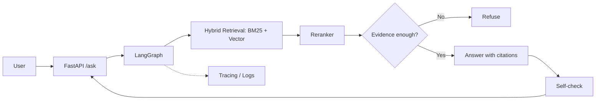

# CiteGuard

> Agentic RAG for technical docs that answers **only with evidence**: every claim is cited, and it refuses when evidence is insufficient.

**Live Demo:** <!-- TODO: Hugging Face Spaces URL -->  
<!-- TODO: demo GIF (assets/demo.gif) -->

## Architecture
<!-- TODO: replace with final diagram (assets/architecture.png) -->


## Evaluation
| Metric | Baseline RAG | CiteGuard |
|---|---|---|
| Faithfulness (RAGAS) | TBD | TBD |
| Context Recall (RAGAS) | TBD | TBD |
| Refusal Accuracy | TBD | TBD |
| p95 Latency | TBD | TBD |

Test set: ~100 Q&A pairs incl. unanswerable questions. <!-- TODO: link eval/ -->

Week 1 retrieval numbers (Recall@5 / MRR): see [`docs/eval_week1.md`](docs/eval_week1.md).

## Quickstart

### Local (no Docker — embedded Qdrant)

```bash
cp .env.example .env
# leave QDRANT_URL empty for embedded mode
sed -i 's|^QDRANT_URL=.*|QDRANT_URL=|' .env

python -m venv .venv && source .venv/bin/activate
pip install -e ".[dev]"

# Raw docs are expected under data/raw/ (see Data Sources). Then:
python scripts/ingest_docs.py          # chunk + BM25 + embeddings → Qdrant
uvicorn citeguard.api.app:app --host 0.0.0.0 --port 8000

curl localhost:8000/health
curl -X POST localhost:8000/search \
  -H 'Content-Type: application/json' \
  -d '{"query":"How do I add CORS in FastAPI?","top_k":5}'
```

### Docker Compose

```bash
cp .env.example .env   # set LLM_API_KEY when Week 2 /ask lands
docker compose up -d --build
curl -X POST localhost:8000/search -H 'Content-Type: application/json' \
  -d '{"query":"How do I add CORS in FastAPI?","top_k":5}'
# Week 2:
# curl -X POST localhost:8000/ask -H 'Content-Type: application/json' \
#   -d '{"question":"How do I add CORS in FastAPI?"}'
```

HF Spaces tip: unset `QDRANT_URL` so the API uses Qdrant embedded/local disk mode (single container).

## API
- `POST /search` hybrid retrieval results (`query`, `top_k`, optional `method`: `bm25|vector|hybrid|hybrid+rerank`)
- `POST /ask` cited answer or refusal (streaming) — Week 2
- `GET /health`

## Design Decisions
- **Hybrid retrieval**: BM25 + `bge-small-en-v1.5` vectors fused with RRF (`k=60`), then `bge-reranker-base` cross-encoder.
- **Local models only** for Week 1 (no paid embedding/LLM APIs).
- **Qdrant URL optional**: empty → embedded path under `data/indexes/qdrant_local` (Spaces-friendly).
- Refusal threshold / LangGraph `/ask` — Week 2.

## Roadmap
- [x] Week 1: ingest + hybrid `/search` + eval
- [ ] Week 2: cited `/ask` + refuse-when-unsure (LangGraph)
- [ ] Week 3: RAGAS eval board (~100 Q)
- [ ] Week 4: tracing, Docker demo, README polish
- [ ] MCP tool interface

## Data Sources

Corpus is pinned to the commits below (public docs, all MIT). **Do not pull LangGraph docs from `langchain-ai/langgraph`** — the maintained source is `langchain-ai/docs` (`src/oss/langgraph/`); the langgraph repo `docs/` is not the canonical docs tree for this project.

| Source | Repo | Path | License | Pinned commit |
|---|---|---|---|---|
| FastAPI | [`fastapi/fastapi`](https://github.com/fastapi/fastapi) | `docs/en/` | MIT | `f5c6e9b4f9cadc1bf0f9a1fd672e621206b63007` |
| Pydantic | [`pydantic/pydantic`](https://github.com/pydantic/pydantic) | `docs/` | MIT | `22c4317a5d51d71344275259b4e536c4a90fe53b` |
| LangGraph | [`langchain-ai/docs`](https://github.com/langchain-ai/docs) | `src/oss/langgraph/` (MDX) | MIT | `a28c75411093fdc0e57b03c1d6486ba78f005f51` |

Ingest writes per-doc `source_url`, `source_commit`, and `license` into `data/manifest.json`. First ingest used ~290 markdown/MDX files (within the 300–500 target).

Chunking: Markdown-heading-aware, ~500 tokens, 50-token overlap (`tiktoken` cl100k_base).

## License
MIT
